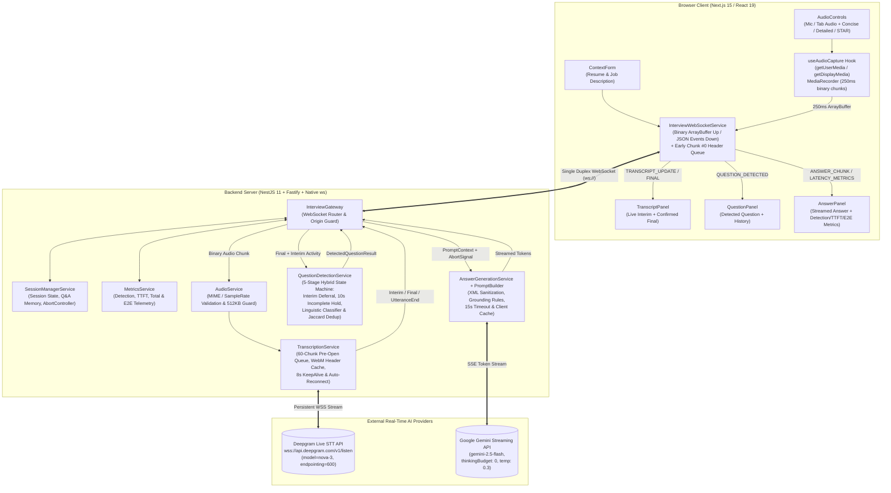
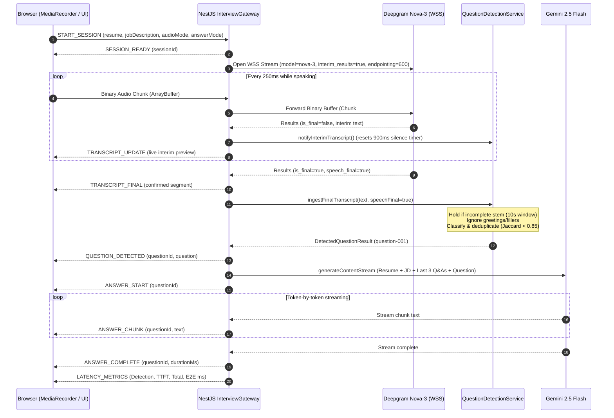

# Real-Time AI Interview Assistant

A low-latency, real-time interview copilot engineered to listen to live virtual interviews (Google Meet, Zoom, Teams, or microphone input), transcribe speech on the fly via **Deepgram Nova-3**, detect when an interviewer finishes asking a substantive question while ignoring small talk and mid-sentence thinking pauses, and stream speakable, resume-grounded answers token-by-token using **Google Gemini 2.5 Flash**.

Built around a strict **sub-3-second Time-to-First-Token (TTFT)** latency budget (`Audio Capture → Binary WS Transport → Streaming STT → Hybrid Stateful Question Detection → Streaming LLM → Live UI`).

---

## 1. Setup & Run Instructions (From a Clean Machine)

### Prerequisites
- **Node.js:** `>= 20.0.0` (verify with `node -v`)
- **npm:** `>= 10.0.0` (uses native npm workspaces; no global CLI dependencies required)
- **Browser:** Chromium-based browser (Chrome, Edge, Brave) recommended for browser-tab audio capture (`getDisplayMedia` with tab audio sharing); Microphone mode (`getUserMedia`) works in all modern browsers.
- **API Keys:**
  - **Deepgram API Key:** [Create a free key at console.deepgram.com](https://console.deepgram.com/) ($200 free credit tier; supports `nova-3` and `nova-2` streaming).
  - **Google Gemini API Key:** [Create a free key at aistudio.google.com](https://aistudio.google.com/) (supports `gemini-2.5-flash`).

### Step 1: Clone & Install Dependencies
From the root of the repository, install dependencies for both `apps/backend` and `apps/frontend` workspaces in one command:
```bash
git clone https://github.com/chaitanya07422/real-time-interview-assistant.git
cd real-time-interview-assistant
npm install
```

### Step 2: Configure Environment Variables
Copy `.env.example` to `.env` in the repository root. The NestJS backend automatically resolves `.env` from either the repository root or `apps/backend/.env`:
```bash
cp .env.example .env
```

Open `.env` and add your `DEEPGRAM_API_KEY` and `GEMINI_API_KEY`:
```env
# --- Backend Configuration ---
PORT=4000
FRONTEND_ORIGIN=http://localhost:3000

# Deepgram Streaming Speech-to-Text Configuration
DEEPGRAM_API_KEY=your_deepgram_api_key
DEEPGRAM_MODEL=nova-3

# Google Gemini API Configuration
GEMINI_API_KEY=your_gemini_api_key
GEMINI_MODEL=gemini-2.5-flash

# Question Detection Silence Threshold (ms)
QUESTION_SILENCE_THRESHOLD_MS=900

# --- Frontend Configuration ---
NEXT_PUBLIC_BACKEND_WS_URL=ws://localhost:4000
```
> **Security Note:** API keys are read exclusively by the backend process (`apps/backend`). No secret keys are prefixed with `NEXT_PUBLIC_` or exposed to the browser bundle.

### Step 3: Start Backend & Frontend
Open two terminal tabs from the repository root:

**Terminal 1 — Start the NestJS + Fastify WebSocket Backend (Port `4000`):**
```bash
npm run dev:backend
```
Verify backend health at `http://localhost:4000/health` (`{"status":"ok","service":"real-time-interview-assistant-backend"}`).

**Terminal 2 — Start the Next.js 15 Frontend (Port `3000`):**
```bash
npm run dev:frontend
```
Open **`http://localhost:3000`** in your browser.

### Step 4: Using the Application (Live Audio or Demo Simulation)
1. **Provide Candidate Context:** Paste your **Resume / Professional Summary** and the target **Job Description** (or click **"Load Sample Context"** to populate a realistic Senior Engineer profile).
2. **Choose Audio Source & Answer Mode:**
   - **Mode B (Microphone Audio):** Captures speech directly from your microphone.
   - **Mode A (Browser Tab Audio):** Captures audio directly from a Google Meet / Zoom / YouTube tab (select the tab in the browser picker and check **"Also share tab audio"**).
   - **Answer Mode:** Choose **Concise** (default, 60–90 words / 3–5 speakable bullets), **Detailed** (130–180 words with architectural depth), or **STAR Format** (`Situation`, `Task`, `Action`, `Result` for behavioral questions).
3. **Start Listening or Trigger Quick Demo Questions:**
   - Click **Start Listening** and speak an interview question (or play an interview clip), **or**
   - Click any of the **Quick Demo Question Trigger** buttons (`"Tell me about yourself."`, `"How did you improve AI response latency?"`, etc.) to exercise the full backend Question Detection → Gemini Streaming → Latency Telemetry pipeline without speaking into a mic.

### Step 5: Verify Automated Tests, Typecheck, and Production Build
```bash
# Run all 22 unit & end-to-end WebSocket pipeline tests
npm test

# Run strict TypeScript typechecking across backend and frontend
npm run lint

# Build production bundles for both backend (NestJS) and frontend (Next.js)
npm run build
```

---

## 2. System Architecture & End-to-End Data Flow

### System Architecture Diagram (Mermaid)


### Real-Time Sequence Flow (Mermaid)


### Complete Execution Flow & Latency Budget (`< 3.0s` Target)
To consistently hit sub-3-second Time-to-First-Token after an interviewer stops speaking, every stage of the pipeline is non-blocking and streaming:

| Pipeline Stage | Engineering Mechanism | Verified / Typical Latency |
|---|---|---|
| **1. Audio Capture** | `MediaRecorder.start(250)` emits 250ms Opus/WebM slices | `125ms – 250ms` |
| **2. WS Transport** | Raw binary `ArrayBuffer` frames over `ws` (zero Base64 serialization) | `1ms – 15ms` |
| **3. Streaming STT** | Deepgram `nova-3` streaming WebSocket with `endpointing=600` | `150ms – 600ms` |
| **4. Question Detection** | In-memory stateful regex/heuristic evaluation on `speech_final` | `< 2ms` (or `~900ms` on silence timer fallback) |
| **5. LLM First Token (TTFT)** | Cached `GoogleGenAI` client + `gemini-2.5-flash` (`thinkingBudget: 0`) | `450ms – 1,250ms` |
| **6. UI Token Render** | Direct `ANSWER_CHUNK` dispatch keyed by `questionId` | `< 16ms` (1 frame) |
| **Total End-to-End (E2E)** | **End of interviewer speech → First answer token on screen** | **`0.8s – 2.1s`** |

---

## 3. Key Architectural Decisions & Engineering Trade-Offs

### 3.1 Why Deepgram `nova-3` over Whisper / AssemblyAI (and Raw `ws` over SDK)
- **Why Deepgram `nova-3`:** OpenAI Whisper is a batch encoder-decoder architecture; wrapping it in chunked pseudo-streaming introduces 1.5–3.0s of buffering latency and hallucinated repetitions on silence. Deepgram's `nova-3` is a native streaming speech model with sub-300ms acoustic-to-token latency, built-in smart formatting (`smart_format=true`, `numerals=true`), and high accuracy on software engineering terms (`NestJS`, `Fastify`, `PostgreSQL`, `p95`, `WebSockets`). We also built automatic handshake fallback to `nova-2` if a restricted API key does not have `nova-3` enabled.
- **Why Direct `ws` Instead of `@deepgram/sdk`:** We bypassed `@deepgram/sdk` and connected directly to `wss://api.deepgram.com/v1/listen` via Node's native `ws` package. This gives us deterministic control over handshake timeouts (`10s`), `KeepAlive` frames (`8s`), HTTP status inspection on `unexpected-response`, and zero-copy `Buffer` forwarding.
- **Solving the WebM Chunk `#0` Header Trap:** Browser `MediaRecorder` outputs `audio/webm;codecs=opus` where **only the first chunk (`chunk #0`) contains the EBML/WebM container header**, and subsequent chunks are raw Opus clusters. If `chunk #0` is dropped while the Deepgram TLS handshake is opening—or during a mid-session STT reconnect—Deepgram cannot decode subsequent audio. We solved this at both layers:
  1. On the frontend (`useInterviewSocket.ts`), any `MediaRecorder` chunk emitted before `START_SESSION` is queued and flushed in order immediately after session creation.
  2. On the backend (`TranscriptionService`), `chunk #0` is cached as `initHeaderChunk` and queued in a bounded pre-open buffer (`MAX_PENDING_CHUNKS = 60`), allowing us to replay the EBML header automatically even if the Deepgram socket reconnects mid-interview.

### 3.2 Why Google Gemini (`gemini-2.5-flash`) with `thinkingBudget: 0`
- **Latency vs. Reasoning Trade-Off:** Waiting 4+ seconds for a reasoned essay leaves the candidate in awkward silence. `gemini-2.5-flash` has very fast prefill speed, but by default Gemini 2.5 allocates internal "thinking" tokens before emitting the first visible token. By setting `thinkingConfig: { thinkingBudget: 0 }` and `temperature: 0.3`, we eliminate internal reasoning overhead and cut Time-to-First-Token to **~450–950ms** while maintaining strict adherence to resume facts.
- **Spoken-Voice Prompt Engineering & Anti-Hallucination Grounding:** Our `PromptBuilder` enforces first-person spoken cadence (contractions, plain verbs, 10–20 word glanceable bullets), strict grounding (`Never invent experience, skills, projects, metrics, or employers`), honest pivoting when asked about an unfamiliar tool (*"I haven't used Kafka in production, but I've worked with..."*), and XML boundary sanitization (`sanitizeUntrustedContext`) so pasted job descriptions cannot escape `<job_description>` tags via prompt injection.
- **Preemptive Stream Cancellation (`AbortController`):** If an interviewer asks a question and immediately follows up or rephrases, `SessionManagerService` aborts the in-flight Gemini stream via `AbortController` before starting the new one so tokens from two answers never interleave.

### 3.3 How Question Detection Works (Stateful Hybrid Engine vs. LLM Classifier)
Calling an LLM classifier on every final STT transcript adds **300–600ms of serial network latency** before answer generation can begin and burns rate limits on small talk. Conversely, checking `text.endsWith('?')` fails on imperative prompts (*"Walk me through your system design"*, *"Tell me about yourself"*) and triggers prematurely when an interviewer pauses mid-sentence.

We built a **5-stage deterministic state machine** (`QuestionDetectionService` + `question-patterns.ts`) that executes in **< 2ms**:
1. **Interim-Speech Silence Timer Deferral:** When Deepgram emits a final segment with `speech_final: false`, we start a `900ms` silence timer. Incoming `is_final: false` **interim transcripts** call `notifyInterimTranscript()`, resetting that silence timer in real time so a multi-clause question is never cut off while the interviewer is still actively speaking.
2. **Mid-Sentence Incomplete-Stem Hold Buffer (`10s` Window):** Interviewers frequently pause mid-thought (*"Tell me about a time where you handled the..."* [3s pause] *"...migration to Fastify"*). Before firing on `speech_final` or `UtteranceEnd`, `looksIncompletePhrase()` checks whether the accumulated utterance ends with a dangling preposition, conjunction, article, or incomplete stem (`"what was the"`, `"how did you"`). If so, the engine **holds the segment in buffer for up to 10 seconds** and merges the continuation clause when the interviewer finishes their sentence.
3. **Greeting, Small-Talk & Short-Filler Isolation:** Short 1–2 word utterances (`"Hello."`, `"Sure."`, `"Got it."`, `"Sounds good."`, `"I see."`), greetings (`"Hi, how are you?"`), and AV checks (`"Can you hear me okay?"`, `"Is my mic working?"`) are recognized as complete non-questions and discarded immediately so they never pollute the continuation buffer.
4. **Sentence Segmentation, Prefix Stripping & Linguistic Classification:** Compound utterances (*"Okay, great. Walk us through your system architecture."*) are split by sentence; conversational prefixes (`"Okay, great"`, `"Sure"`, `"Got it"`) are stripped; and each sentence is tested against four interview structures:
   - **Direct Interrogatives:** `what`, `why`, `how`, `when`, `where`, `who`, `which`
   - **Modal / Auxiliary Starters:** `can you/we`, `could you/we`, `would you`, `have you ever`, `did you`, `do you`, `are you`
   - **Imperative Interview Prompts:** `tell me/us about`, `walk me/us through`, `describe`, `explain`, `share an example`, `give me/us an example`, `elaborate on`, `compare and contrast`
   - **Indirect Prompts:** `I'd love to hear about`, `I'm curious about`, `let's talk about`, `let's discuss`
5. **Dual-Layer Deduplication:** Prevents re-answering the same question via normalized string comparison, a 60-second substring containment check, and token-level **Jaccard similarity (`>= 0.85`)**.

---

## 4. Known Limitations

1. **Single-Channel Audio in Microphone Mode (No Speaker Diarization):** In **Mode B (Microphone Audio)** where both interviewer and candidate are picked up by the same mic, the audio stream is single-channel. (**Mode A: Browser Tab Audio** avoids this because capturing a meeting tab only captures remote participants' audio, not the local microphone).
2. **`MediaRecorder` Container Framing vs. Raw PCM:** Browser `MediaRecorder` wraps Opus frames inside a WebM container (`250ms` slices), which requires chunk `#0` header preservation and adds ~100–150ms of browser encoding latency compared to raw PCM frames.
3. **Heuristic Boundary Edge Cases:** Purely declarative prompts where an interviewer states a fact (*"Your resume mentions Redis"*) and waits silently without an interrogative, imperative, or indirect cue are ignored by design to avoid false-positive answers on normal statements.
4. **Single-Node In-Memory State:** Session state (`SessionManagerService`), metrics (`MetricsService`), and STT stream handles live in process memory.

---

## 5. What I Would Build Next With Another Week

1. **Dual-Stream Acoustic Channel Separation (`Tab = Channel 0 [Interviewer]`, `Mic = Channel 1 [Candidate]`):**
   - Simultaneously capture the meeting tab (`getDisplayMedia`) and the candidate's microphone (`getUserMedia`) into separate channels. This guarantees **zero false triggers** from the candidate's own voice, feeds the candidate's *actual spoken answers* into `<conversation_context>`, and auto-checks off bullet points on screen as the candidate speaks them.
2. **Speculative Context Pre-Fetching on Interim Transcripts:**
   - Index the candidate's resume, GitHub READMEs, and architecture notes into structured claim chunks, and trigger **speculative retrieval on interim transcripts** while the interviewer is still 70% through speaking the question—so relevant project metrics are already assembled in memory the millisecond `speech_final` fires.
3. **`AudioWorklet` Linear16 PCM Pipeline (`16kHz` Mono):**
   - Replace `MediaRecorder` WebM blobs with a custom WebAudio `AudioWorkletProcessor` streaming raw `16kHz` 16-bit Linear PCM (`audio/pcm`). Every PCM frame is self-describing, enabling zero-downtime mid-utterance STT failover without container headers and shaving ~120ms off audio capture latency.
4. **Asynchronous Ambiguous-Utterance Micro-Classifier:**
   - Keep the `< 2ms` deterministic state machine as the primary fast path (handling ~95% of questions instantly), and run an async fallback micro-classifier (`gemini-2.5-flash-lite`) *only* when an utterance is rejected by heuristics yet followed by > 1.5s of silence.

---

## 6. Top 3 Production Risks & Mitigations (≤ 300 Words)

### 1. Audio Privacy, Two-Party Consent, and Data Security
Capturing live interview audio introduces strict legal and privacy obligations (e.g., GDPR, CCPA, and two-party recording consent laws) alongside risks of exposing sensitive PII in resumes and transcripts.
- **Mitigation:** Enforce explicit user consent workflows and visible recording indicators; scrub PII before external API transmission; enforce TLS/WSS encryption in transit and zero-retention flags (`mip_opt_out` on Deepgram, zero data retention on Gemini); and authenticate WebSocket sessions via short-lived JWTs with strict per-tenant isolation.

### 2. Real-Time Reliability, Latency Spikes, and Provider Outages
The sub-3-second Time-to-First-Token (TTFT) target depends on persistent stateful WebSockets and two external cloud providers (Deepgram and Gemini). Network jitter, provider rate limits, or regional outages can break active interviews.
- **Mitigation:** Deploy multi-provider failover (e.g., AssemblyAI/Whisper fallback for STT; OpenAI/Anthropic fallback for LLM) behind circuit breakers and health checks; move session state to Redis for seamless horizontal scaling and stateful WebSocket recovery; and colocate backend edge nodes near STT/LLM regions.

### 3. LLM Hallucinations, Prompt Injection, and Answer Quality
Under low-latency constraints, the LLM may fabricate candidate experience, produce overly verbose text that sounds unnatural when spoken, or fall victim to prompt injection embedded in pasted job descriptions.
- **Mitigation:** Isolate untrusted resume/job-description inputs using strict XML delimiters and input sanitization; pre-index candidate resumes into structured claims for retrieval-augmented grounding; enforce post-generation citation/fact checks; and continuously evaluate output conciseness and faithfulness using automated LLM-as-a-judge benchmarks.


